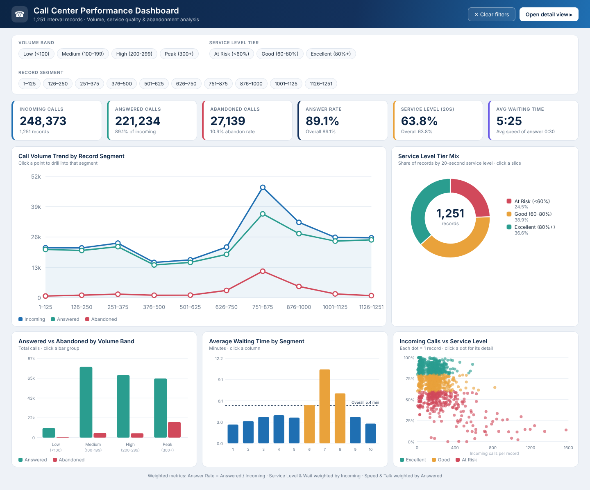
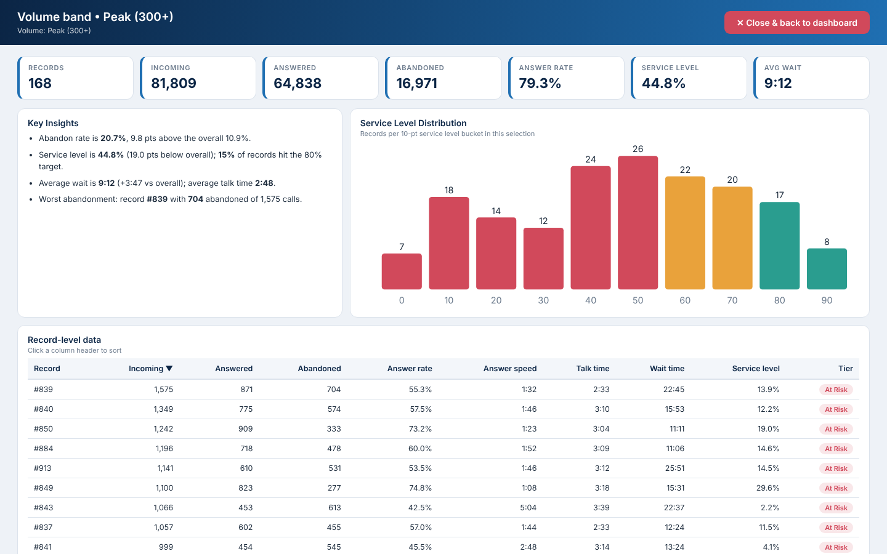

# 📞 Call Center Performance Dashboard

An interactive, Power BI–style analytics dashboard built from 1,251 call-center interval records.
Open `Call_Center_Dashboard.html` in any browser — no installation, no internet needed.



## Highlights
- **6 KPI cards** – Incoming, Answered, Abandoned, Answer Rate, Service Level (20 s), Avg Waiting Time
- **5 visuals** – volume trend, service-tier donut, answered vs abandoned by volume band, wait time by segment, calls-vs-service-level scatter
- **Slicers** – Volume band, Service tier, Record segment (multi-select, cross-filtering)
- **Drill-through detail page** – click any chart element, KPI card or scatter dot → a full detail page opens (KPIs, auto-generated insights, distribution, sortable record table) with a **Close** button (or `Esc`) to return
- **Clear filters** button, hover tooltips, dimmed non-selected items (Power BI-like highlight)



## Key findings
| Metric | Value |
|---|---|
| Incoming calls | 248,373 |
| Answered / Abandoned | 221,234 / 27,139 |
| Answer rate | 89.1 % (abandon rate 10.9 %) |
| Service level (20 s) | 63.8 % |
| Avg waiting time | 5:25 |

- Records 626–1000 (peak period) carry the heaviest volume; segment 7 (751–875) has the worst waiting time (~10.5 min) and the highest abandonment.
- Peak-volume records (300+ calls) abandon ~21 % of calls vs 5–6 % for low, medium and high volume → a staffing problem at peaks.
- 24.5 % of records are "At Risk" (service level < 60 %).

## Data preparation
| Step | Result |
|---|---|
| Duplicate rows | 0 found (full-row and ignoring `Index`) |
| Missing values | 0 |
| `Answer Rate`, `Service Level` (text like `94.01%`) | converted to numeric 0–1 |
| `Answer Speed`, `Talk Duration`, `Waiting Time` (text `h:mm:ss`) | converted to seconds (integer) |
| Integrity check | Answered + Abandoned = Incoming for all 1,251 rows ✔ |
| Derived columns | `Abandon_Rate`, `Volume_Band`, `Service_Tier`, `Segment` (10 blocks of ~125 records) |

**Important:** the source file has no date, agent, or department column, only a sequential `Index`. Time-based analysis is therefore by *record segment*, not by calendar month. Nothing was invented.

Cleaned data: `Call_Center_Data_Cleaned.csv`

## Metric definitions
- Answer Rate = Σ Answered / Σ Incoming
- Service Level & Avg Wait = weighted by Incoming calls
- Avg Answer Speed & Talk Duration = weighted by Answered calls
- Volume bands: Low <100, Medium 100–199, High 200–299, Peak 300+
- Service tiers: At Risk <60 %, Good 60–80 %, Excellent ≥80 %

## Rebuilding in Power BI Desktop (.pbix)
A `.pbix` can only be authored in Power BI Desktop, so this repo ships the HTML version plus the recipe:
1. **Get Data → Text/CSV →** `Call_Center_Data_Cleaned.csv` (types already correct).
2. DAX measures:
```DAX
Total Incoming = SUM(Calls[Incoming_Calls])
Total Answered = SUM(Calls[Answered_Calls])
Total Abandoned = SUM(Calls[Abandoned_Calls])
Answer Rate = DIVIDE([Total Answered],[Total Incoming])
Abandon Rate = DIVIDE([Total Abandoned],[Total Incoming])
Service Level = DIVIDE(SUMX(Calls,Calls[Service_Level_20s]*Calls[Incoming_Calls]),[Total Incoming])
Avg Wait (sec) = DIVIDE(SUMX(Calls,Calls[Waiting_Time_Sec]*Calls[Incoming_Calls]),[Total Incoming])
```
3. Visuals: 6 Card visuals, Line chart (Segment_Label), Donut (Service_Tier), Clustered column (Volume_Band), Column (Segment), Scatter (Incoming vs Service_Level).
4. Slicers: `Volume_Band`, `Service_Tier`, `Segment_Label`.
5. Drill-through: create a page "Detail", add a table + KPIs, drag `Volume_Band`/`Service_Tier`/`Segment_Label` into *Drill-through filters*, and add a **Back** button (Insert → Buttons → Back).
6. Palette: Navy `#0B2545`, Blue `#1F6FB2`, Teal `#2A9D8F`, Amber `#E9A23B`, Red `#D1495B`; font Segoe UI.

## Files
`Call_Center_Dashboard.html` · `Call_Center_Data_Cleaned.csv` · `Dashboard_Screenshot.png` · `Detail_Page_Screenshot.png` · `Dashboard_Showcase.pptx` · `Dashboard_Showcase_Video.mp4` · `README.md`
